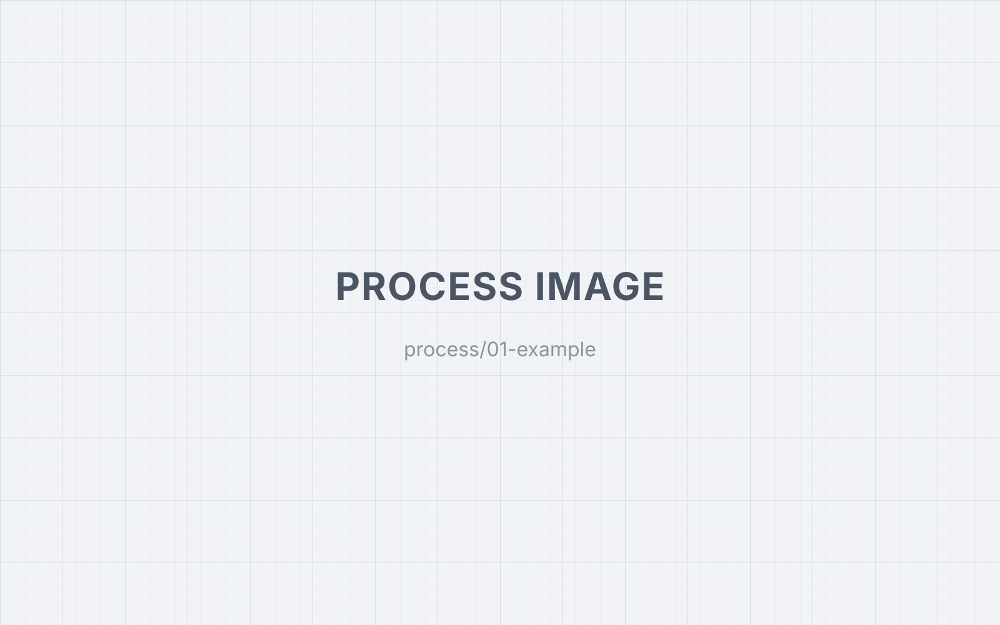

---
# ============================================================
#  NEW PROJECT TEMPLATE
#  1. Copy this whole _TEMPLATE folder inside projects/
#  2. Rename the copy, e.g.  projects/rc-plane-wing/   (lowercase, dashes, no spaces)
#  3. Fill in the lines below and write your sections
#  (The settings between the two --- lines are called "front matter".)
# ============================================================

layout: project                 # keep this line exactly as is
title: "Project Title"
summary: "One sentence that shows up on the project card."
cover: cover.svg                # image file in this folder, e.g. cover.jpg
tags: [Personal]                # one or more of: Class, Team, Personal, Research
date: 2026-01-15                # YYYY-MM-DD. Newest projects appear first.
when: "Spring 2026"             # optional: how the date is displayed
role: "What YOU did on this project"
tools: [SOLIDWORKS, MATLAB]     # list as many as you like
team: "4 students"              # optional: delete this line if solo
featured: false                 # true = show on the Home page
hidden: false                   # true = hide from the site (draft)
---

## Overview

What is this project, and why does it matter? 2–4 sentences.

## Process

Walk through how you did it: CAD, calculations, iterations, failures, and fixes.

*Optional caption: an italic line right under the image.*

## Results

What you achieved. Numbers are great (weight saved, efficiency gained, grade, award).
