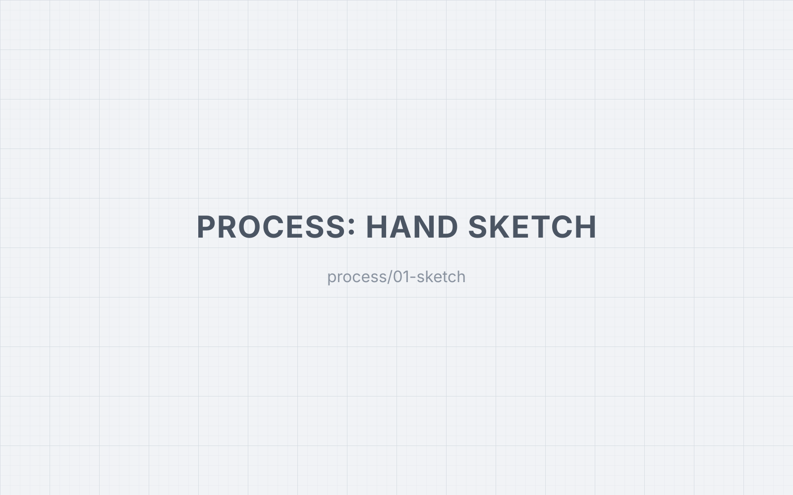
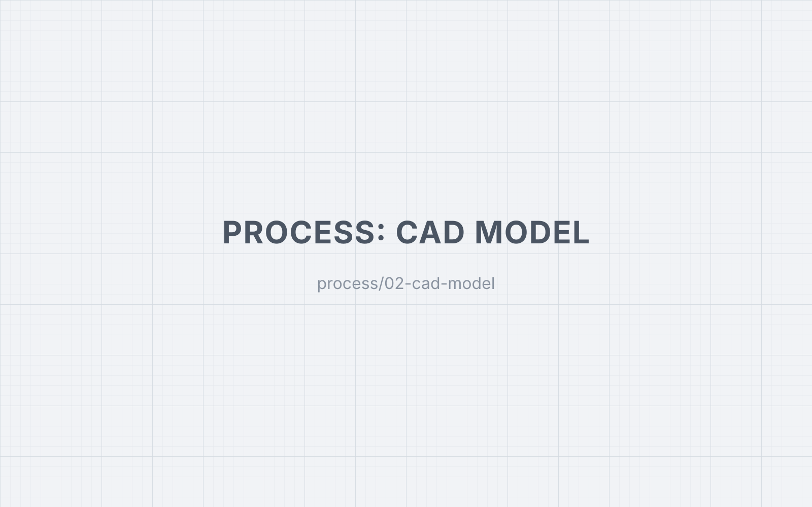

> **Placeholder project.** Replace the text and images below with your own ME 1670 work.

## Overview

A short paragraph on what the project was and why it mattered. For example: *ME 1670 covers
engineering graphics: sketching, 3D solid modeling, and creating drawings that someone else
could manufacture from. The final project was to model a multi-part assembly and document
it with a complete drawing package.*

**Goal:** One sentence on what "done" looked like.

## Process

### 1. Hand sketches

Start with how you approached the problem. Explain your thinking, not just the steps.

*Early hand sketch showing front, top, and right views.*

### 2. 3D modeling in SOLIDWORKS

Describe your feature strategy (base extrude → cuts → fillets), design intent, and how you
kept the model easy to edit.

*Part model with the feature tree. Dimensions are driven by key design parameters.*

### 3. What went wrong (and the fix)

Recruiters love this section. Mention a mistake, such as an over-constrained sketch, a
mating error, or a missing dimension caught in review, and what you learned from it.

### 4. Drawings

Explain the drawing package: views chosen, section views, dimension scheme, title block.

## Results

- Final deliverable: e.g. *assembly of N parts plus a drawing set of N sheets*
- A measurable outcome or grade, if you want to share it
- One thing you would do differently next time
